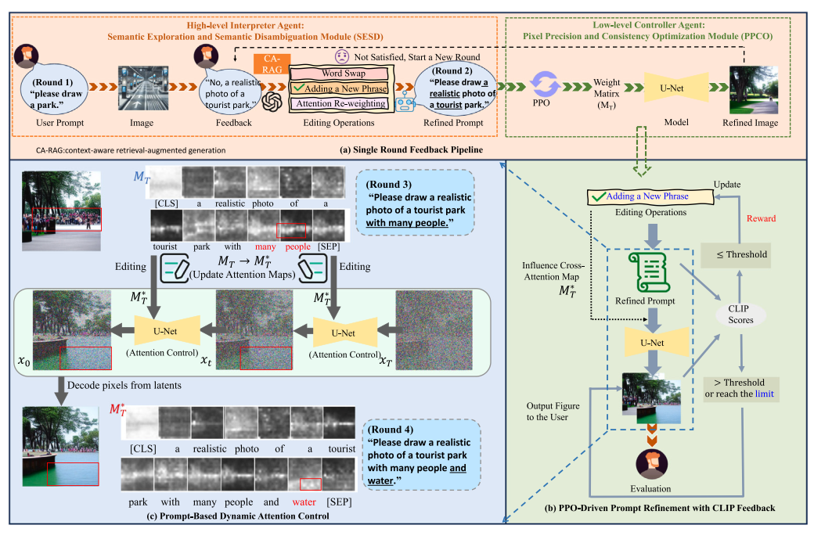
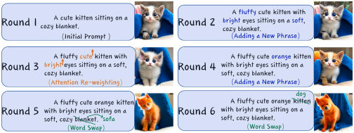

# Visual Co-Adaptation (VCA)

**A paper-based independent implementation of interactive intent clarification and image refinement.** This repository implements the core workflow described in *Enhancing intent understanding for ambiguous prompt: A human–machine co-adaption strategy* (Neurocomputing, 2025). It connects multi-turn language interaction, context-aware retrieval, diffusion cross-attention editing, CLIP feedback, and PPO-based policy learning in a runnable project.

> **Reproduction scope.** The cited VCA paper is the sole methodological source; the paper PDF is not redistributed in this repository. This is an independent engineering implementation, not a line-by-line recovery of the authors’ private code. Explicitly underspecified equations and execution details are documented as implementation assumptions. We do not claim to reproduce the paper’s private model weights, full training scale, human study, or reported performance metrics.

## Paper overview

Text-to-image systems can produce visually plausible images while missing what a user meant by an ambiguous prompt. A word such as “mouse” can refer to an animal or a computer device; a short prompt may also leave style, viewpoint, or scene details unstated. Asking users to write a fully specified prompt up front places the burden on the user.

The paper proposes **Visual Co-Adaptation (VCA)**: a human and a generation system iteratively clarify intent and refine an image. The system maintains the prompt and interaction history, asks or interprets clarifying feedback, retrieves contextual knowledge, edits cross-attention during diffusion, and uses image–text alignment feedback to update its editing policy. The user’s next response then guides another generation round.

**Paper:** Yijin Wang, Yangfan He, Jianhui Wang, Kun Li, Li Sun, Jun Yin, Miao Zhang, and Xueqian Wang. “Enhancing intent understanding for ambiguous prompt: A human–machine co-adaption strategy.” *Neurocomputing*, 646 (2025), 130415. [https://doi.org/10.1016/j.neucom.2025.130415](https://doi.org/10.1016/j.neucom.2025.130415).

## Framework architecture

The figure below is the paper’s VCA overview (Fig. 2). **SESD** turns the request and conversation into a clarified prompt with retrieved context. **PPCO** uses the revised intent to edit diffusion cross-attention and generate an image. The image is scored against the previous and revised prompts; the image, updated prompt, feedback, and policy experience form the state for the next interaction round.



The paper’s ambiguity examples and iterative-refinement illustration are included for context:

| Ambiguity motivating clarification | Iterative refinement concept |
|---|---|
|  |  |

The runtime connection is implemented in [`VCARuntime.step`](src/vca/runtime/pipeline.py): dialogue and RAG produce a prompt proposal; a policy selects an editing action; the diffusion adapter generates an image with the attention controller; CLIP computes the dual reward; PPO/replay update policy state; and the session records the new prompt, feedback, image, and experience. `finalize()` records the completed session. The actual image-generation and policy path is connected rather than a set of isolated demonstrations.

## Methodology

The equations below highlight the parts that determine the interaction and optimization behavior. Equation numbers and page references refer to the paper PDF. The complete Eq. (1)–(33) audit, including ambiguities, tests, and implementation classifications, is in [`docs/equation_audit.md`](docs/equation_audit.md); the source/test index is [`docs/paper_to_code_matrix.md`](docs/paper_to_code_matrix.md).

### Incremental dialogue, SESD, and context-aware RAG

The paper gives an incremental history-conditioned dialogue (Eq. 1, p. 4), followed by a compact current-prompt/current-feedback recurrence (Eq. 2, p. 5):

$$
y_{t+1}=M(p_{refine}\parallel x\parallel y_0\parallel fb_0\parallel\cdots\parallel y_t\parallel fb_t),
\qquad
y_{t+1}=M(x\parallel y_t\parallel fb_t).
$$

Here, $x$ is the original request, $y_t$ is the current refined prompt, $fb_t$ is user feedback, and $M$ is the language model. SESD maintains the multi-turn state, detects when intent is still ambiguous, and can return a clarifying question instead of treating an incomplete interpretation as settled. The source provides an offline rule-backed path and configurable local/provider LLM interfaces. The paper’s exact system prompt, ambiguity thresholds, stopping rule, and original fine-tuned language-model weights are not available; those operational details are implementation assumptions.

**Context-Aware RAG (CA-RAG)** retrieves relevant knowledge using the current prompt, feedback, and semantic category, then supplies that evidence to refinement/disambiguation. See Algorithm 3 (p. 6). The included seed knowledge base is a small, auditable resource, not the paper’s full knowledge corpus. Real model runs can use CLIP text embeddings for retrieval; the lightweight offline path is provided for tests. Neither path is claimed to reproduce an unspecified original retrieval encoder or index.

Relevant code: [`sesd/dialogue.py`](src/vca/sesd/dialogue.py), [`sesd/disambiguation.py`](src/vca/sesd/disambiguation.py), [`sesd/rag.py`](src/vca/sesd/rag.py), [`sesd/knowledge_base.py`](src/vca/sesd/knowledge_base.py), and [`sesd/llm.py`](src/vca/sesd/llm.py).

### CLIP semantic alignment and reward

The paper defines CLIP alignment as the cosine between image and text embeddings (Eq. 4, p. 5) and uses a two-prompt reward (Eq. 14, p. 7):

$$
s(I,p)=\mathbf f_I^\top\mathbf f_T,\qquad
R_t=\mathrm{CLIP}(I_t,y_{t-1})+\lambda\mathrm{CLIP}(I_t,y_t),\quad \lambda=0.2.
$$

$I_t$ is the generated image; $y_{t-1}$ and $y_t$ are the previous and revised prompts. The implementation reports the raw cosine terms and applies the paper’s stated previous/new weighting. It does not substitute a scaled CLIP logit or claim that a single cosine is a direct estimate of true mutual information.

The paper’s mutual-information discussion (Eqs. 3–13, pp. 5–7) relies on distributional assumptions, and its Eq. 13 update sign conflicts with the stated maximization direction. The project retains those equations in the audit but does not claim to optimize true conditional mutual information. CLIP reward is measured after generation; gradients do **not** pass through the discrete sampling/PIL generation path.

Code: [`scoring/clip_reward.py`](src/vca/scoring/clip_reward.py), [`scoring/mi.py`](src/vca/scoring/mi.py).

### PPCO and cross-attention editing

PPCO (Pixel Precision and Consistency Optimization) conditions edits on the alignment between the old and new prompts and the current diffusion attention. The implementation captures and injects cross-attention maps in a frozen Diffusers Stable Diffusion 1.5 sampling path. It supports three paper-described operations (Eqs. 21, 23, 27–28, p. 8):

* **Attention-Replace (Eq. 21):** replace attention for selected aligned tokens according to the paper’s threshold rule. The source/target map convention is ambiguous in the PDF; the safe implementation uses an explicitly documented mapping choice.
* **Attention-Refine (Eqs. 23 and 27):** align tokens across prompts, preserve the target map for newly inserted tokens, and blend aligned source and target maps with a mixing coefficient. The exact mapper dimensions, normalization, and coefficient learning are not fully specified in the paper.
* **Attention-Reweight (Eq. 28):** alter selected token emphasis. The literal equation’s multiplicative scaling can yield negative entries or attention rows that no longer sum to one for allowed values of its coefficient. The safe execution path uses a documented logit-bias-and-softmax variant; this is an implementation assumption, not a literal claim of equivalence.

The controller records attention edits and shape/alignment traces; `scripts/test_attention_effect.py` compares no-edit and edited sampling under shared prompts/latents. This is functional evidence that the operators affect real sampling, not evidence that the edits improve image quality in general.

Code: [`editing/controllers.py`](src/vca/editing/controllers.py), [`editing/token_alignment.py`](src/vca/editing/token_alignment.py), [`editing/attention_capture.py`](src/vca/editing/attention_capture.py), and [`editing/pipeline_adapter.py`](src/vca/editing/pipeline_adapter.py).

### PPO Actor–Critic, TD error, and prioritized replay

The paper defines one-step temporal-difference error (Eq. 18, p. 7):

$$
\delta_t=r_t+\gamma V(s_{t+1})-V(s_t),
$$

where $s_t$ is the interaction state, $r_t$ the reward, $V$ the critic, and $\gamma$ the discount. The implementation masks the bootstrap at terminal transitions. The paper’s Eq. 19 (p. 7) gives raw priority proportional to the age-decayed absolute TD error, $p_i\propto e^{-\lambda t_i}|\delta_i|+\epsilon$. The implementation makes sampling normalization and importance weights explicit:

$$
q_i=e^{-\lambda_{age}\,age_i}\lvert\delta_i\rvert+\epsilon,\qquad
p_i=\frac{q_i}{\sum_jq_j},\qquad
w_i=(N p_i)^{-\beta}.
$$

Here $age_i$ is the stored transition’s age (the paper denotes age by $t_i$), $\lambda_{age}$ is the replay age-decay coefficient, $\epsilon$ is the priority floor, $N$ is the eligible rollout size, and $\beta$ is the importance-weight exponent. The paper’s $\lambda=0.2$ in Eq. 14 is a separate reward coefficient. Importance weights $w_i$ are applied in the PPO loss. The clipped surrogate objective is Eq. 20 (p. 7):

$$
L^{\mathrm{clip}}(\theta)=\mathbb E_t\left[\min\left(\rho_t\hat A_t,
\mathrm{clip}(\rho_t,1-\epsilon_{\mathrm{clip}},1+\epsilon_{\mathrm{clip}})\hat A_t\right)\right],
\qquad \rho_t=\frac{\pi_\theta(a_t\mid s_t)}{\pi_{\mathrm{old}}(a_t\mid s_t)}.
$$

The rollout stores old-policy log probabilities and policy versions. PPO updates use compatible on-policy behavior-policy data; older policy versions are diagnostic rather than silently treated as fresh PPO trajectories. The paper does not fully specify stale-trajectory correction or all replay details, so this restriction is an explicit implementation choice.

### Mapper / Alpha learning and human feedback

The paper’s mapper and attention-coefficient updates (Eqs. 22–27 and 29–33, p. 8) do not define a complete differentiable path through token correspondence, sampled discrete actions, diffusion generation, and the CLIP score. This implementation includes learnable edit/action mapping and blend parameters in the PPO policy and updates them through policy-gradient/score-function estimates. It does **not** claim direct CLIP backpropagation through the generated image into Mapper/Alpha, nor that fixed token alignment by itself reproduces the paper’s underspecified mapper gradient.

Ordinary text entered at the interactive prompt is treated as user feedback and passed into the next SESD round. Optional `/rate 1..5` ratings are logged; the paper does not specify a unique formula for combining an explicit numeric rating with Eq. 14, so the project does not invent another default reward objective. `/satisfied` ends the interaction. The saved session links prompt history, feedback, generated images, rewards, actions, and policy updates for inspection.

## Paper-to-code map

| Paper component | Main implementation | Notes |
|---|---|---|
| Fig. 2 / Algorithm 1, VCA loop | [`runtime/pipeline.py`](src/vca/runtime/pipeline.py), [`runtime/session.py`](src/vca/runtime/session.py) | Connects dialogue → retrieval → generation/edit → reward → policy/replay → next round. |
| Eq. 1–2 / Algorithm 2, SESD | [`sesd/dialogue.py`](src/vca/sesd/dialogue.py), [`sesd/llm.py`](src/vca/sesd/llm.py) | Multi-turn history, clarification and configurable LLM backend; prompts/stopping details are assumptions. |
| Algorithm 3, CA-RAG | [`sesd/rag.py`](src/vca/sesd/rag.py), [`data/knowledge.json`](data/knowledge.json) | Semantic retrieval and knowledge fusion; seed KB is not the full original corpus. |
| Eq. 4, 6, 14, CLIP reward | [`scoring/clip_reward.py`](src/vca/scoring/clip_reward.py) | Raw cosine and previous/new prompt reward. |
| Eq. 21–28, attention edit | [`editing/controllers.py`](src/vca/editing/controllers.py), [`editing/token_alignment.py`](src/vca/editing/token_alignment.py) | Replace, Refine, Reweight; ambiguous dimensions/conventions are documented. |
| Eq. 16, diffusion execution | [`editing/pipeline_adapter.py`](src/vca/editing/pipeline_adapter.py) | Frozen Diffusers pipeline with real cross-attention injection. |
| Eq. 18–20, TD/PPO/replay | [`rl/rollout.py`](src/vca/rl/rollout.py), [`rl/replay.py`](src/vca/rl/replay.py), [`rl/ppo.py`](src/vca/rl/ppo.py) | TD targets, priorities/importance weights, old log-probabilities, clipped objective. |
| Eq. 22–33, learnable action/edit parameters | [`rl/mapper_alpha.py`](src/vca/rl/mapper_alpha.py), [`rl/policy.py`](src/vca/rl/policy.py) | PPO score-function optimization; not direct image-path CLIP gradients. |
| Catalog validation/preparation | [`dataset.py`](src/vca/dataset.py), [`scripts/audit_dataset.py`](scripts/audit_dataset.py), [`scripts/prepare_catalog.py`](scripts/prepare_catalog.py) | Provenance-aware local catalog tools; no dataset is bundled. |

Core tests are under [`tests/`](tests/). See [`docs/paper_to_code_matrix.md`](docs/paper_to_code_matrix.md) for individual formulas, test names, and fidelity labels.

## Installation

Use 64-bit **Python 3.12**. The default dependencies install the project in editable mode and include the basic test extra. They do not download model weights.

### Windows PowerShell

```powershell
git clone https://github.com/Kevin3777/Enhancing-intent-understanding-for-ambiguous-prompt.git
cd Enhancing-intent-understanding-for-ambiguous-prompt
py -3.12 -m venv .venv
.\.venv\Scripts\python.exe -m pip install -r requirements.txt
.\.venv\Scripts\python.exe -m pip check
.\.venv\Scripts\python.exe -c "import vca; print(vca.__file__)"
.\.venv\Scripts\python.exe -m pytest -q
```

### Linux / macOS

```bash
git clone https://github.com/Kevin3777/Enhancing-intent-understanding-for-ambiguous-prompt.git
cd Enhancing-intent-understanding-for-ambiguous-prompt
python3.12 -m venv .venv
.venv/bin/python -m pip install -r requirements.txt
.venv/bin/python -m pip check
.venv/bin/python -c 'import vca; print(vca.__file__)'
.venv/bin/python -m pytest -q
```

`requirements.txt` references the local package and its test extra. [`pyproject.toml`](pyproject.toml) is the dependency and package-discovery source of truth. On a supported NVIDIA Windows/Linux setup, choose a PyTorch wheel matching your driver and CUDA runtime using the [official PyTorch installation selector](https://pytorch.org/get-started/locally/); install the selected Torch/Torchvision pair in the virtual environment, then install `requirements.txt`. A CPU-only option is documented in [`requirements-cpu.txt`](requirements-cpu.txt). CPU is suitable for import checks and the weight-independent suite, but not practical SD1.5 generation. Standard macOS PyTorch installation may be used for package-level work; macOS GPU generation has not been validated by this project. Real generation requires a compatible CUDA GPU and adequate VRAM; the low-budget path was exercised on an RTX 3080 10 GB.

## Models and data

### Model weights

Weights are deliberately excluded from Git and are not downloaded by the Python dependency installation. The pinned model IDs and revisions are in [`configs/model.yaml`](configs/model.yaml); the fetch scripts verify files where hashes are available.

| Role | Model | Suggested path | License / status |
|---|---|---|---|
| Text-to-image | [Stable Diffusion 1.5](https://huggingface.co/stable-diffusion-v1-5/stable-diffusion-v1-5) | `models/sd15/` | CreativeML OpenRAIL-M; review the model card and license before use. |
| Image/text alignment and retrieval embedding | [OpenAI CLIP ViT-B/32](https://huggingface.co/openai/clip-vit-base-patch32) | `models/clip/` | Review the model card and applicable terms. |
| Optional local dialogue LLM | [Qwen2.5-1.5B-Instruct-GGUF](https://huggingface.co/Qwen/Qwen2.5-1.5B-Instruct-GGUF) | `models/qwen25_15b_q4/` | Apache-2.0 model card; engineering substitute for the paper’s fine-tuned LLM. |

The pinned payload is approximately 3.6 GB total (about 2.0 GB SD1.5, 0.6 GB CLIP, and 1.1 GB Qwen GGUF). Reserve at least 6 GB for model files and partial downloads, in addition to the Python environment. Check licenses and access requirements before downloading. From the repository root:

```powershell
.\.venv\Scripts\python.exe scripts\fetch_assets.py
.\.venv\Scripts\python.exe -m pip install -r configs\requirements-local-llm.txt
.\.venv\Scripts\python.exe scripts\fetch_local_llm_gguf.py --out models\qwen25_15b_q4
```

The first script fetches SD1.5 and CLIP under `models/sd15/` and `models/clip/`; the second fetches the optional local LLM. Review and accept the terms on each model’s official page first. For an HTTP-compatible provider, set `VCA_LLM_ENDPOINT`, `VCA_LLM_API_KEY`, and `VCA_LLM_MODEL` in the process environment instead of using the local LLM. Never commit credentials.

### Data

The paper reports 1,673 JSON files and a 95/5 split (Sec. 4.2, pp. 8–9). This repository does not include those original files or claim to reconstruct the exact original split. Dataset sources examined during the project include [Image_prompt](https://huggingface.co/datasets/naseele/Image_prompt), a separate [project dataset page](https://huggingface.co/datasets/Kevin3777/Enhancing_Intent_Understanding), and [Zenodo record 14876029](https://zenodo.org/records/14876029); their metadata and redistribution terms differ, and availability in a public listing alone does not establish permission to redistribute. The data seen during local engineering validation was independently assembled and deduplicated (3,086 annotation records) and is **not equivalent** to the paper’s original 1,673-file dataset. Redistribution rights for the complete catalog were not established, so it is excluded.

Catalog preparation defaults to a hash-ordered 95/5 assignment, explicitly labeled an implementation assumption rather than the paper’s split. Catalogs are JSON Lines files: each line contains a `record` with a non-empty `prompt`, its `record_sha256`, provenance in `sources`, and ordered `qa_pairs` containing actual `question`, `answer`, and optionally `refined_prompt` fields; `split` may label `train` or `validation`. The loader verifies record hashes, provenance, uniqueness, prompt validity, and the required number of turns. Keep training and validation records separate and use only data you are permitted to access and process. `data/knowledge.json` is the small retrieval seed knowledge base; it is not the image/dialogue dataset. See [`scripts/audit_dataset.py`](scripts/audit_dataset.py), [`scripts/prepare_catalog.py`](scripts/prepare_catalog.py), and [`src/vca/dataset.py`](src/vca/dataset.py) for input schema, provenance checks, and preparation behavior.

## Quick start

Run commands from the repository root. Each output command needs a new output directory; scripts preserve existing runs rather than overwrite them. Use `.\.venv\Scripts\python.exe` on Windows or `.venv/bin/python` on Linux/macOS.

### Single image generation

After preparing SD1.5 weights:

```powershell
.\.venv\Scripts\python.exe scripts\smoke_inference.py `
  --prompt "a photo of a cat sitting on a wooden table" `
  --size 256 --steps 8 --seed 42 --out outputs\single-image
```

### Multi-turn interactive refinement

After preparing SD1.5 and CLIP, with the optional local Qwen model for real LLM calls:

```powershell
.\.venv\Scripts\python.exe scripts\interactive_demo.py `
  --prompt "a mouse sitting on a wooden desk" `
  --local-llm models\qwen25_15b_q4 `
  --mapper-alpha learned --action-authority policy `
  --size 256 --steps 8 --max-rounds 3 `
  --out outputs\interactive
```

Type natural-language feedback at `Feedback>`. The CLI also accepts `/undo`, `/rate 1..5`, `/satisfied`, and `/quit`. Use `--provider` with the environment variables above for a compatible remote LLM. `--fixture` runs a fixed three-feedback integration path; it is useful for scripted checks but is not a human study or a real LLM validation. The rule-backed default is an offline path, not evidence of real-LLM behavior.

### Attention editing and PPO training

The real attention-effect check requires SD1.5 and CLIP weights and runs Replace, Refine, and Reweight comparisons with shared latents:

```powershell
.\.venv\Scripts\python.exe scripts\test_attention_effect.py --size 256 --steps 8 --seed 42 --out outputs\attention-check
```

A small model-independent PPO wiring run needs no diffusion weights:

```powershell
.\.venv\Scripts\python.exe scripts\train_ppo.py --env toy --seeds 0 1 2 --iterations 60 --out outputs\toy-ppo
```

A low-budget PPO run through the real diffusion/runtime path requires SD1.5, CLIP, and a prepared local catalog (or the explicitly labeled scripted fixture when `--catalog` is omitted):

```powershell
.\.venv\Scripts\python.exe scripts\train_ppo.py `
  --env diffusion --catalog data\catalog.jsonl `
  --episodes 2 --rollout-episodes 2 --seeds 42 --minibatch 6 `
  --size 256 --steps 8 --local-llm models\qwen25_15b_q4 `
  --mapper-alpha learned --out outputs\ppo-run
```

### Tests

```powershell
.\.venv\Scripts\python.exe -m pytest -q
```

The publication-copy run of the weight-independent suite in a fresh Python 3.12 environment completed with **77 passed, 6 skipped**. The skipped saved-evidence checks require local model-backed artifacts intentionally excluded from the repository. The main project’s earlier validation record reports 83 passing tests. These are software/function checks, not paper performance results.

## Results and visual examples

The following local run used real SD1.5/CLIP diffusion generation and attention editing at 384 px and 20 sampling steps. The three feedback strings were scripted and SESD used its deterministic offline rule path; these images are qualitative code-path evidence, not a human evaluation or a claim that each edit improves quality.

| Stage | Prompt / feedback | Result |
|---|---|---|
| Initial generation | “a mouse sitting on a wooden desk” |  |
| Round 1 — Replace | Feedback: “computer device”; refined prompt: “a computer mouse sitting on a wooden desk” |  |
| Round 2 — Add detail | Feedback: “add a red mouse pad”; refined prompt adds “with a red mouse pad” |  |
| Round 3 — Reweight | Feedback: “emphasize computer mouse”; prompt retained and token emphasis reweighted |  |

The local low-budget diffusion PPO validation recorded **2 episodes, 6 transitions, and 4 optimizer updates**. Actor, Critic, Mapper, and Alpha parameters each changed by a non-zero amount; prioritized replay participated in the loss. This demonstrates an executed update path only. It is not a performance metric, a full training run, or evidence that the method outperforms an ablation. Exploratory small-sample ablations from the development workspace are not included in this release, so this README makes no superiority claim.

The paper’s reported CLIP score, training scale, evaluation scores, and user-study ratings are not reproduced or claimed here. No paper-level performance conclusion is made from these small local runs.

## Reproduction status and limitations

**Connected and executable core:** multi-turn SESD interfaces and context management; retrieval/knowledge fusion; CLIP cosine and dual-prompt reward; all three attention-edit operators connected to a real Diffusers sampling path; Actor–Critic/PPO with old log probabilities, TD error, prioritized replay and importance weights; learnable policy edit parameters; runtime feedback and iteration loop. Unit, integration, and model-backed checks exist in the repository, though model-backed outputs/weights are not included.

**Important approximations and unresolved details:**

1. The available local Qwen model is not the paper’s original GPT/fine-tuned model. Prompt templates, clarification thresholds, and exact retrieval corpus/encoder are not specified sufficiently to recover uniquely.
2. PPO score-function gradients update the policy’s Mapper/Alpha-like learnable edit parameters. CLIP does not backpropagate through discrete image generation. This is an executable engineering choice for an otherwise unspecified gradient path, not a claim of direct paper-equivalent mapper gradients.
3. Some cross-attention source/target conventions, token mapping shapes, normalization, and coefficient update details are ambiguous in Eqs. 21–33. The safe attention path uses documented executable assumptions; the formula audit preserves the PDF’s literal expressions and points out conflicts.
4. The paper’s original weights, Efficient U-Net pretraining, 12,000-episode / four-RTX-4090 scale, full original dataset/split, true mutual-information optimization, and human satisfaction study are not reproduced. The project does not claim the paper’s numeric results or complete experimental replication.
5. The illustrative image sequence uses a scripted feedback fixture and offline rule-based SESD. Real LLM use is available through the configured local/provider backends, but the displayed fixture is not evidence of user-facing LLM quality.

For detailed assumptions and unresolved issues, see [`docs/equation_audit.md`](docs/equation_audit.md), [`docs/equation_mapping_addendum.md`](docs/equation_mapping_addendum.md), [`docs/execution_principles.md`](docs/execution_principles.md), [`docs/reproduction_scope.md`](docs/reproduction_scope.md), and [`docs/open_questions.md`](docs/open_questions.md).

## Citation and references

If you use this implementation, please cite the VCA paper and identify this repository as an independent paper-based implementation:

```bibtex
@article{wang2025enhancingintent,
  title   = {Enhancing intent understanding for ambiguous prompt: A human--machine co-adaption strategy},
  author  = {Wang, Yijin and He, Yangfan and Wang, Jianhui and Li, Kun and Sun, Li and Yin, Jun and Zhang, Miao and Wang, Xueqian},
  journal = {Neurocomputing},
  volume  = {646},
  pages   = {130415},
  year    = {2025},
  doi     = {10.1016/j.neucom.2025.130415}
}
```

Related foundations include [CLIP](https://arxiv.org/abs/2103.00020), [Retrieval-Augmented Generation](https://arxiv.org/abs/2005.11401), [Proximal Policy Optimization](https://arxiv.org/abs/1707.06347), [Prompt-to-Prompt cross-attention control](https://arxiv.org/abs/2208.01626), and [Latent Diffusion Models](https://arxiv.org/abs/2112.10752). The implementation uses these as infrastructure/context; the VCA PDF remains the only source for the reproduced method definition.

## License and model/data terms

Check the repository license, paper figure permissions, each model’s license, and the terms of any dataset before use or redistribution. Model weights and the full data catalog are not included. No credentials or author-local model paths are required for the weight-independent tests.
